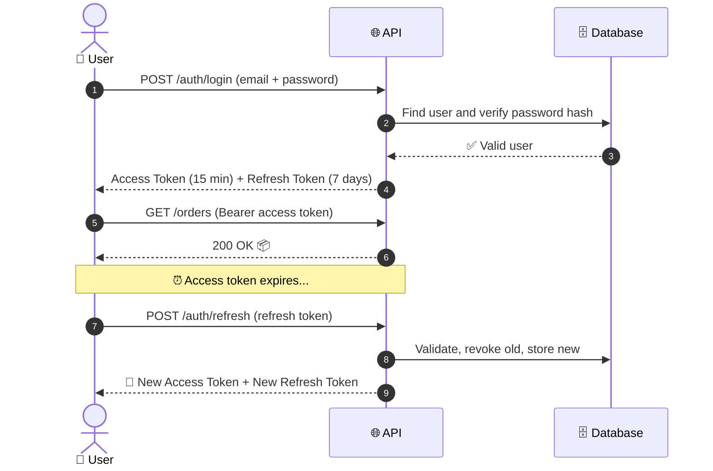
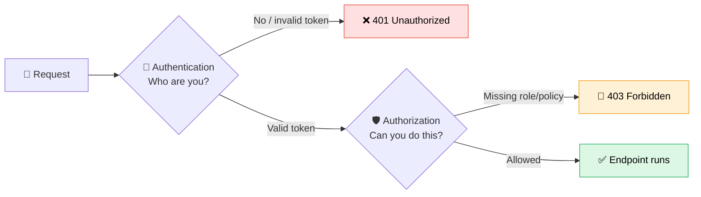

<div align="center">

# 🔐 edu-dotnet-auth - Luis Starlino

### Learn authentication and authorization in .NET, step by step

From password hashing to JWT, refresh tokens and role-based access,
built as a hands-on course with one module per branch.

<br>


<br>

[📚 What You'll Learn](#-what-youll-learn) •
[🗺️ Learning Path](#️-learning-path) •
[🚀 Getting Started](#-getting-started) •
[🧠 Key Concepts](#-key-concepts) •
[🏆 Challenges](#-challenges)

</div>

<br>

---

## 📚 What You'll Learn

> **Authentication** answers *"who are you?"*
> **Authorization** answers *"what are you allowed to do?"*
> This repository teaches both, the right way.

<table>
<tr>
<td width="50%" valign="top">

### 🔑 Authentication
- Secure password hashing
- ASP.NET Core Identity
- Issuing and validating **JWT**
- Refresh token rotation
- Logout and token revocation

</td>
<td width="50%" valign="top">

### 🛡️ Authorization
- `[Authorize]` and `[AllowAnonymous]`
- Role-based access control (Rules)
- Claims and policies
- Custom authorization handlers
- Protecting Minimal API endpoints

</td>
</tr>
</table>

---

## 🗺️ Learning Path

Each module lives in its own branch, so students can follow the evolution of the code, compare changes and jump to any point of the course.

| # | Module | Branch | Topics |
|:-:|--------|--------|--------|
| 00 | 🧱 **Presentation** | `module-00-setup-minimal` | Project setup, Minimal APIs|
| 01 | 🧱 **Foundations** | `module-01-foundations` | Project setup, Minimal APIs, EF Core |
| 02 | 🔒 **Passwords** | `module-02-passwords` | Hashing, salting, why never plain text |
| 03 | 👤 **Identity** | `module-03-identity` | Register, login, user store |
| 04 | 🎫 **JWT** | `module-04-jwt` | Token anatomy, signing, validation |
| 05 | 🔄 **Refresh Tokens** | `module-05-refresh-tokens` | Rotation, expiration, revocation |
| 06 | 👑 **Roles & Policies** | `module-06-authorization` | Roles, claims, custom policies |
| 07 | 🌐 **External Login** | `module-07-external-login` | OAuth 2.0 with Google / GitHub |
| ✅ | 🎓 **Final Version** | `main` | Everything together |

```bash
# Jump to any module
git checkout module-04-jwt

# See what changed between two modules
git diff module-03-identity module-04-jwt
```

---

## 🔄 How It Works

### The authentication flow



### Inside the request pipeline



---

## 🧰 Tech Stack

| Tool | Purpose |
|------|---------|
|  | Web API with Minimal APIs |
|  | User management and password hashing |
|  | Data access and migrations |
|  | Zero-setup database for the classroom |
|  | Token-based authentication |
|  | Interactive API docs |
|  | Automated tests |

---

## 🚀 Getting Started

### Prerequisites

- [.NET 10 SDK](https://dotnet.microsoft.com/download)
- An editor: [VS Code](https://code.visualstudio.com/), [Visual Studio](https://visualstudio.microsoft.com/) or [Rider](https://www.jetbrains.com/rider/)
- *(optional)* [Git](https://git-scm.com/) to switch between modules

### Run in 3 steps

```bash
# 1. Clone the repository
git clone https://github.com/your-username/edu-dotnet-auth.git
cd edu-dotnet-auth

# 2. Apply the database migrations
dotnet ef database update --project src/EduAuth.Api

# 3. Run the API
dotnet run --project src/EduAuth.Api
```

Then open **`https://localhost:5001/scalar`** to explore and test every endpoint. 🎉

> [!TIP]
> Prefer testing from the editor? Open `requests.http` in VS Code (REST Client extension) or Visual Studio and click **Send Request**.

---

## 📁 Project Structure

```
edu-dotnet-auth/
├── 📂 src/
│   └── 📂 EduAuth.Api/
│       ├── 📂 Auth/            # Login, register, refresh endpoints
│       ├── 📂 Data/            # DbContext and migrations
│       ├── 📂 Entities/        # User, RefreshToken
│       ├── 📂 Services/        # TokenService, PasswordService
│       ├── 📂 Policies/        # Custom authorization handlers
│       ├── 📄 Program.cs       # Pipeline configuration
│       └── 📄 appsettings.json
├── 📂 tests/
│   └── 📂 EduAuth.Tests/       # Unit and integration tests
├── 📂 docs/                    # Slides, diagrams, extra material
├── 📄 requests.http            # Ready-to-run API requests
└── 📄 README.md
```

---

## 🌐 API Endpoints

| Method | Endpoint | Auth | Description |
|:------:|----------|:----:|-------------|
|  | `/auth/register` | 🔓 | Create a new account |
|  | `/auth/login` | 🔓 | Get access + refresh tokens |
|  | `/auth/refresh` | 🔓 | Exchange a refresh token for new tokens |
|  | `/auth/logout` | 🔒 | Revoke the current refresh token |
|  | `/me` | 🔒 | Current user's profile and claims |
|  | `/admin/users` | 👑 | List users (**Admin** role only) |

<sub>🔓 Public &nbsp;•&nbsp; 🔒 Authenticated &nbsp;•&nbsp; 👑 Admin only</sub>

---

## 🧠 Key Concepts

<details>
<summary><b>🔑 Authentication vs Authorization</b></summary>
<br>

| | Authentication | Authorization |
|---|---|---|
| **Question** | Who are you? | What can you do? |
| **Happens** | First | After authentication |
| **Failure** | `401 Unauthorized` | `403 Forbidden` |
| **Example** | Checking your ID at the door | Checking if you have VIP access |

</details>

<details>
<summary><b>🎫 Anatomy of a JWT</b></summary>
<br>

A JWT has three parts separated by dots: `header.payload.signature`

```
eyJhbGciOiJIUzI1NiJ9 . eyJzdWIiOiIxMjMiLCJyb2xlIjoiQWRtaW4ifQ . SflKxwRJSMeKKF2QT4fw
└──── Header ────┘     └────────────── Payload ──────────────┘    └── Signature ──┘
  algorithm, type         claims: user id, role, expiration        proves integrity
```

⚠️ The payload is **encoded, not encrypted**. Anyone can read it, so never put secrets in a JWT.

</details>

<details>
<summary><b>🔄 Why refresh tokens?</b></summary>
<br>

Short-lived access tokens limit the damage if one is stolen. Refresh tokens let users stay logged in without typing their password again. With **rotation**, every refresh issues a new refresh token and revokes the old one, so a stolen token can only be used once.

</details>

<details>
<summary><b>🔒 Why hash passwords?</b></summary>
<br>

If the database leaks, hashed passwords can't simply be read back. Identity uses **PBKDF2** with a unique salt per user, so identical passwords produce different hashes and precomputed attacks become impractical.

</details>

---

## 🏆 Challenges

Finished a module? Put your knowledge to the test:

- [ ] 🟢 Add a `/auth/change-password` endpoint
- [ ] 🟢 Lock the account after 5 failed login attempts
- [ ] 🟡 Create a policy that only allows users over 18
- [ ] 🟡 Store refresh tokens in an `HttpOnly` cookie
- [ ] 🔴 Implement email confirmation on register
- [ ] 🔴 Add two-factor authentication (TOTP)

<sub>🟢 Beginner &nbsp;•&nbsp; 🟡 Intermediate &nbsp;•&nbsp; 🔴 Advanced</sub>

---

## ⚠️ Teaching vs Production

> [!WARNING]
> This project is built for **learning**. Some choices favor clarity over production readiness. Before shipping real software:
> - Store secrets in **User Secrets**, environment variables or a vault, never in `appsettings.json`
> - Use a production database instead of SQLite
> - Enable HTTPS everywhere and configure CORS carefully
> - Add rate limiting to the login endpoint
> - Consider a dedicated identity provider for larger systems

---

## 🤝 Contributing

Found a bug, a typo, or have an idea for a new module? Contributions are welcome!

1. Fork the repository
2. Create a branch: `git checkout -b fix/my-improvement`
3. Commit your changes: `git commit -m "fix: explain refresh token rotation better"`
4. Open a Pull Request 🚀

---

## 📄 License

Distributed under the **MIT License**. Use it freely in your own classes, courses and study groups. See [`LICENSE`](LICENSE) for details.

<br>

<div align="center">

### 👨‍🏫 Made with ❤️ for teaching

If this project helped you learn, consider giving it a ⭐

**[Your Name](https://github.com/your-username)** •
[LinkedIn](https://linkedin.com/in/your-profile) •
[YouTube](https://youtube.com/@your-channel)

</div>